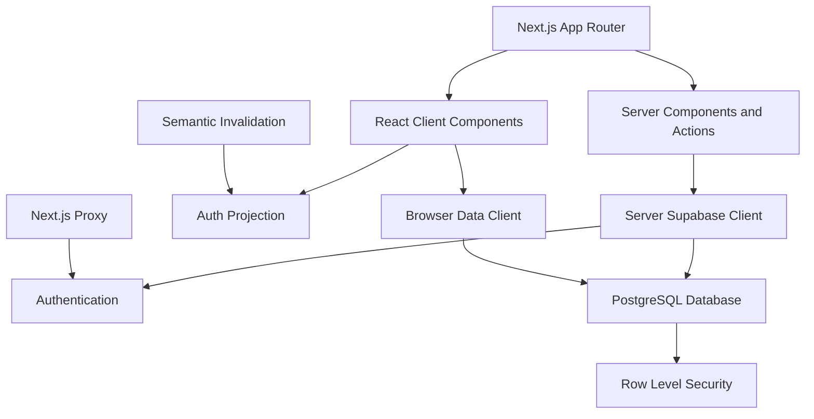
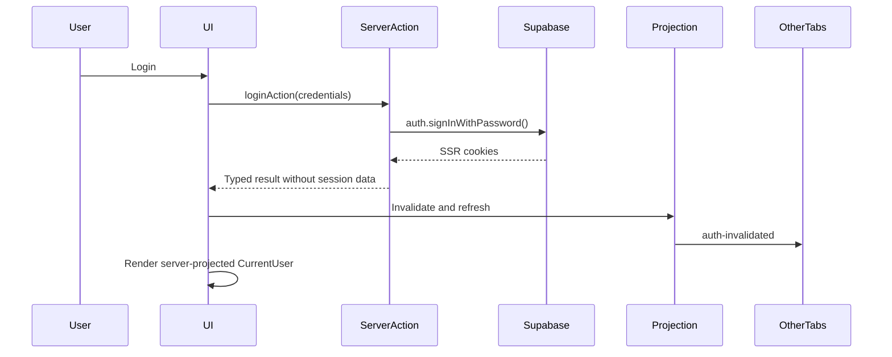
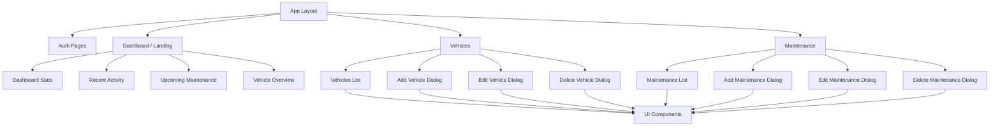
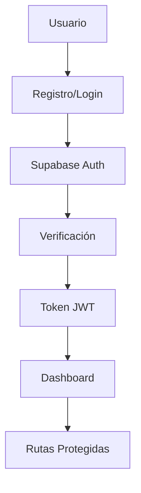
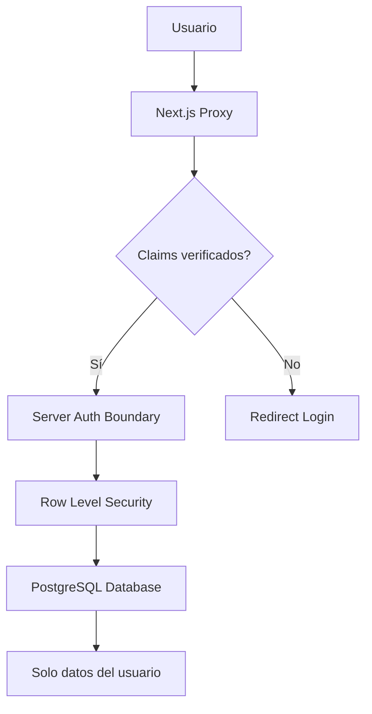
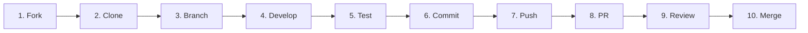

# 🚗 Keepel

<p align="center">
  <strong>Sistema completo de gestión de mantenimiento automotriz</strong>
</p>

<p align="center">
  Una aplicación web moderna y completa para gestionar el mantenimiento de vehículos, construida con Next.js, TailwindCSS y Supabase.
</p>

<p align="center">
  <a href="#demo">Ver Demo</a> •
  <a href="#características">Características</a> •
  <a href="#arquitectura">Arquitectura</a> •
  <a href="#instalación">Instalación</a> •
  <a href="#documentación">Documentación</a> •
  <a href="#contribuir">Contribuir</a>
</p>

---

[](https://nextjs.org/)
[](https://reactjs.org/)
[](https://www.typescriptlang.org/)
[](https://supabase.com/)
[](https://tailwindcss.com/)
[](https://opensource.org/licenses/MIT)

## 🎯 Características Destacadas

### 🔐 Autenticación Server-Authoritative

Keepel mantiene la sesión y los comandos de autenticación en el servidor:

- ✅ **Proyección Tipada**: El navegador recibe solo `AuthState` y `CurrentUser`
- ✅ **Comandos en el Servidor**: Login, registro, OAuth y logout no exponen tokens al cliente
- ✅ **Sincronización Cross-Tab**: BroadcastChannel transmite únicamente invalidaciones semánticas
- ✅ **Proxy con Claims Verificados**: Protección temprana y refresh de cookies SSR en el servidor
- ✅ **Cliente de Datos Único**: Supabase en el navegador se conserva solo para operaciones de datos

## 📸 Demo

> 🚧 **Nota**: Las capturas de pantalla serán agregadas próximamente

## ✨ Características

<table>
<tr>
<td>

### 🚙 **Gestión de Vehículos**

- Registro completo de vehículos
- Información detallada (marca, modelo, año, VIN)
- Control de kilometraje
- Edición y eliminación segura

</td>
<td>

### 📅 **Programación de Servicios**

- Recordatorios de mantenimiento
- Programación de servicios futuros
- Previsiones por fecha o kilometraje, con resolución explícita

</td>
</tr>
<tr>
<td>

### 💰 **Control de Gastos**

- Seguimiento de costos detallado
- Análisis de gastos por período
- Reportes financieros
- Gráficos y estadísticas

</td>
<td>

### 📋 **Historial Completo**

- Registro detallado de servicios
- Notas y observaciones

</td>
</tr>
<tr>
<td>

### 📊 **Dashboard Intuitivo**

- Vista general centralizada
- Estadísticas en tiempo real
- Próximos mantenimientos
- Actividad reciente

</td>
<td>

### 🔐 **Seguridad Avanzada**

- Autenticación con Supabase
- Protección de rutas
- Row Level Security (RLS)
- Sesiones seguras

</td>
</tr>
</table>

### 🎨 **Experiencia de Usuario**

- 📱 **Responsive Design**: Funciona perfectamente en móviles, tablets y desktop
- 🌙 **Modo Oscuro**: Tema adaptable según preferencias del usuario
- ♿ **Accesibilidad**: Cumple con estándares WCAG
- ⚡ **Rendimiento**: Optimizado para carga rápida
- 🌐 **Responsive**: Diseño adaptativo para cualquier dispositivo

## 🛠️ Stack Tecnológico

<div align="center">

|                                             Frontend                                             |                                        Backend & Database                                         |                                       Tools & Utilities                                       |
| :----------------------------------------------------------------------------------------------: | :-----------------------------------------------------------------------------------------------: | :-------------------------------------------------------------------------------------------: |
|        |  |  |
|                   |   |                                        |
|  |                              |                        |
|                             |                                |                                |

</div>

### Arquitectura



### Flujo de Autenticación



### Características Técnicas

- **🏗️ App Router**: Utilizando el App Router de Next.js 16
- **🎨 Design System**: Componentes consistentes con shadcn/ui
- **🔄 Datos coherentes**: Mutaciones confirmadas, invalidación y reintento explícito
- **🔐 Auth Server-Authoritative**: Comandos y validación de sesión en el servidor
- **💾 Proyección de Sesión**: Identidad mínima y tipada para la interfaz
- **🔗 Cross-Tab Sync**: Invalidación semántica de auth entre pestañas
- **🔒 Type Safety**: TypeScript en toda la aplicación
- **✅ Form Validation**: Validación robusta con Zod y React Hook Form

## 📋 Requisitos Previos

Antes de comenzar, asegúrate de tener instalado:

| Requisito                                                                                     | Versión           | Enlace                                        |
| --------------------------------------------------------------------------------------------- | ----------------- | --------------------------------------------- |
|      | 20.9.0 o superior | [Descargar](https://nodejs.org/)              |
|           | 1.3.9 (CI)        | [Instalar](https://bun.com/docs/installation) |
|  | Cuenta gratuita   | [Registrarse](https://supabase.com/)          |

## 🚀 Instalación

### Método Rápido (Recomendado)

```bash
# 1. Clonar el repositorio
git clone https://github.com/devchemical/Keepel.git
cd Keepel

# 2. Instalar dependencias
bun install --frozen-lockfile

# 3. Configurar variables de entorno
cp .env.example .env.local
# Edita .env.local con tus credenciales de Supabase

# 4. Ejecutar la aplicación
bun dev
```

### Instalación Paso a Paso

<details>
<summary><strong>📖 Guía Detallada de Instalación</strong></summary>

#### 1. Clonar el Repositorio

```bash
git clone https://github.com/devchemical/Keepel.git
cd Keepel
```

#### 2. Instalar Dependencias

**Con bun (recomendado):**

```bash
bun install --frozen-lockfile
```

#### 3. Configurar Supabase

1. **Crear proyecto en Supabase**
   - Ve a [supabase.com](https://supabase.com)
   - Crea una nueva organización y proyecto
   - Anota la URL y las claves API

2. **Configurar variables de entorno**

   Crea un archivo `.env.local` en la raíz del proyecto:

Copia `.env.example` y configura, como mínimo:

```env
NEXT_PUBLIC_SUPABASE_URL=tu_supabase_url
NEXT_PUBLIC_SUPABASE_ANON_KEY=tu_supabase_anon_key
APP_BASE_URL=http://localhost:3000

UPSTASH_REDIS_REST_URL=tu_upstash_url
UPSTASH_REDIS_REST_TOKEN=tu_upstash_token
KEEPEL_RATE_LIMIT_HMAC_SECRET=un_secreto_independiente_de_al_menos_32_caracteres

KEEPEL_CONSENT_SIGNING_SECRET=otro_secreto_independiente_de_al_menos_32_caracteres

OPENPANEL_API_URL=https://openpanel.chemicaldev.com/api
OPENPANEL_SERVER_CLIENT_ID=
OPENPANEL_SERVER_CLIENT_SECRET=
```

`KEEPEL_CONSENT_SIGNING_SECRET` es obligatorio y debe tener al menos 32 caracteres. Genera un valor aleatorio independiente para cada entorno (local, preview y producción), por ejemplo:

```bash
openssl rand -base64 32
```

Guarda el valor local en `.env.local` y los valores de preview/producción en el gestor de secretos de la plataforma de despliegue. No reutilices valores entre entornos ni guardes secretos generados en el repositorio. `bun run build`, `bun dev` y `bun start` fallan de forma explícita si esta variable falta o es demasiado corta.

Rotar el secreto invalida las preferencias firmadas anteriormente. Tras una rotación, el banner volverá a mostrarse y la analítica permanecerá desactivada hasta que la persona usuaria elija de nuevo.

Las credenciales de OpenPanel son exclusivamente de servidor. Keepel no utiliza una clave `SUPABASE_SERVICE_ROLE_KEY` en la aplicación.

#### 4. Configurar Base de Datos

Para una base nueva, ejecute todos los scripts canónicos `scripts/001`–`010` en orden.
Lea [Configuración de Base de Datos](#️-configuración-de-base-de-datos) y el
[contrato de migraciones](docs/testing/data-api.md) antes de actualizar una base existente.
Los scripts de este repositorio no se aplican mediante `supabase db push`.
Para probar, use exclusivamente `bun run data-api:start` y el arnés local documentado abajo.

#### 5. Ejecutar la Aplicación

```bash
# Desarrollo
bun dev

# Construcción para producción
bun run build
bun start
```

</details>
### 🗄️ Configuración de Base de Datos

Los contratos actuales requieren ejecutar los scripts canónicos `scripts/001`–`010` en orden
en una base nueva. No copie fragmentos antiguos del README: `004` crea previsiones explícitas,
`005` migra los campos heredados **antes** de que `006` los elimine; `007`–`010` añaden
transacciones, confirmaciones y totales completos. Una base existente requiere revisar su
versión y respaldos antes de migrar. Esta aceptación solo ensaya una base local desechable.
Véase [contrato de migraciones](docs/testing/data-api.md).

### Verificación reproducible

Node.js >=20.9, Bun >=1.3 (CI fija 1.3.9), Docker y Supabase CLI 2.75.0.
Instale Chromium con `bun x playwright install --with-deps chromium`.
Ejecute estos comandos en serie, desde el checkout propietario de la pila local:

```bash
bun install --frozen-lockfile
bun fmt:check
bun lint
bun type-check
bun run test
bun run data-api:start
bun run test:data-api
bun run test:e2e
bun run test:data-browser
bun run test:schema
bun run build:local
# Solo al terminar todos los consumidores:
bun run data-api:stop
```

`bun run test` invoca Vitest; el comando nativo `bun test` no sustituye esta suite.
`test:data-api` ensaya SQL real con dos cuentas ordinarias y reinicia exclusivamente la pila
local guardada. `test:data-browser` recorre 1007 registros con Auth/PostgREST/RLS reales.
`test:schema` restaura 001–010, genera tipos del esquema real y exige coincidencia.
`build:local` usa claves públicas de esa pila en memoria y marcadores sintéticos para las
variables obligatorias de Redis, HMAC y consentimiento; no necesita secretos alojados.
Los E2E controlados configuran sus propios servicios y secretos sintéticos.
No ejecute consumidores que reinician la base ni consumidores de `.next` en paralelo.

[Acceptance CI](.github/workflows/acceptance.yml) exige todos estos pasos sin omitir errores
TypeScript ni reintentar pruebas fallidas. El estado **Complete data reliability gate** debe
configurarse como requerido en la protección de la rama (configuración del repositorio).
La [matriz #90](docs/testing/issue-90-acceptance.md) relaciona historias, pruebas y límites.
La analítica CRUD y los identificadores quedan diferidos por decisión expresa del usuario;
se mantiene ADR0002 y no se amplía la recogida de datos.

### ▶️ Ejecutar la Aplicación

Una vez configurado todo, ejecuta:

```bash
bun dev
```

🎉 **¡Listo!** La aplicación estará disponible en `http://localhost:3000`

### 🌐 Despliegue

<details>
<summary><strong>Opciones de Despliegue</strong></summary>

#### Vercel (Recomendado)

[](https://vercel.com/new/clone?repository-url=https://github.com/devchemical/CarCare)

#### Netlify

[](https://app.netlify.com/start/deploy?repository=https://github.com/devchemical/CarCare)

#### Railway

[](https://railway.app/new/template/your-template)

**Variables de entorno necesarias:** consulta `.env.example`. Producción necesita Supabase, Upstash, `APP_BASE_URL`, dos secretos HMAC independientes y, si se habilita analítica consentida, el cliente de escritura de OpenPanel.

</details>

## 📁 Estructura del Proyecto

```
Keepel/
├── 📁 app/                          # Next.js App Router
│   ├── 🔐 auth/                     # Páginas de autenticación
│   │   ├── login/                   # Inicio de sesión
│   │   ├── signup/                  # Registro de usuario
│   │   ├── signup-success/          # Confirmación de registro
│   │   ├── callback/                # OAuth callback
│   │   └── error/                   # Página de errores
│   ├── actions/privacy.ts           # Preferencias firmadas de privacidad
│   ├── 🚗 vehicles/                 # Gestión de vehículos
│   │   ├── page.tsx                 # Lista de vehículos
│   │   └── [id]/maintenance/        # Mantenimiento por vehículo
│   ├── layout.tsx                   # Layout principal
│   ├── page.tsx                     # Landing page / Dashboard
│   └── globals.css                  # Estilos globales + Tailwind theme
├── 📁 components/                   # Componentes React
│   ├── privacy/                     # Consentimiento y preferencias de privacidad
│   ├── auth/                        # Componentes de autenticación
│   ├── dashboard/                   # Componentes del dashboard
│   │   ├── Dashboard.tsx            # Dashboard principal
│   │   ├── dashboard-stats.tsx      # Estadísticas generales
│   │   ├── recent-activity.tsx      # Actividad reciente
│   │   ├── upcoming-maintenance.tsx # Próximos mantenimientos
│   │   └── vehicle-overview.tsx     # Vista general de vehículos
│   ├── home/                        # Landing page components
│   ├── layout/                      # Header, Layout
│   ├── maintenance/                 # Componentes de mantenimiento
│   │   ├── add-maintenance-dialog.tsx    # Agregar mantenimiento
│   │   ├── edit-maintenance-dialog.tsx   # Editar mantenimiento
│   │   ├── delete-maintenance-dialog.tsx # Eliminar mantenimiento
│   │   └── maintenance-list.tsx          # Lista de mantenimientos
│   ├── skeletons/                   # Loading skeletons
│   ├── ui/                          # Componentes UI (shadcn/ui)
│   └── vehicles/                    # Componentes de vehículos
│       ├── add-vehicle-dialog.tsx   # Diálogo agregar vehículo
│       ├── edit-vehicle-dialog.tsx  # Diálogo editar vehículo
│       ├── delete-vehicle-dialog.tsx# Diálogo eliminar vehículo
│       └── vehicles-list.tsx        # Lista de vehículos
├── 📁 contexts/                     # React Contexts
│   ├── AppProviders.tsx             # Root provider tree
│   ├── AuthProjectionContext.tsx    # Proyección de auth desde el servidor
│   ├── DataContext.tsx              # App data + optimistic updates
│   └── SupabaseContext.tsx          # Cliente de datos del navegador
├── 📁 hooks/                        # Custom React hooks
├── 📁 lib/                          # Utilidades y configuración
│   ├── auth/                        # Comandos, proyección e invalidación de auth
│   ├── supabase/                    # Clientes y proxy de Supabase
│   │   ├── client.ts                # Cliente del navegador
│   │   ├── server.ts                # Cliente del servidor
│   │   └── proxy.ts                 # Refresh de sesión y protección de rutas
│   ├── formatters.ts                # Formateadores de datos
│   ├── ratelimit.ts                 # Configuración de rate limiting
│   └── utils.ts                     # Funciones de utilidad
├── 📁 scripts/                      # Scripts SQL de base de datos
│   ├── 001_create_tables.sql        # Creación de tablas
│   ├── 002_create_profile_trigger.sql # Triggers de perfiles
│   ├── 003_maintenance_function.sql # Compatibilidad histórica
│   └── 004–010                      # Previsiones, migración, transacciones y totales
├── 📁 styles/                       # Estilos adicionales
├── 📁 public/                       # Archivos estáticos
│   ├── keepel_logo.svg              # Logo del proyecto
│   └── robots.txt                   # Reglas para crawlers
├── 📄 proxy.ts                      # Proxy de autenticación de Next.js
├── 📄 next.config.mjs               # Configuración de Next.js
├── 📄 tsconfig.json                 # Configuración de TypeScript
└── 📄 package.json                  # Dependencias del proyecto
```

### 🏗️ Arquitectura de Componentes



## 🎯 Funcionalidades Principales

### 🔐 Sistema de Autenticación

<table>
<tr>
<td width="50%">

**Características de Seguridad:**

- ✅ Registro con email y contraseña
- ✅ Inicio de sesión seguro
- ✅ OAuth con Google
- ✅ Protección de rutas con proxy y claims verificados
- ✅ Gestión automática de sesiones
- ✅ Tokens JWT seguros

</td>
<td width="50%">

**Flow de Autenticación:**



</td>
</tr>
</table>

### 🚗 Gestión Completa de Vehículos

| Función                | Descripción                           | Estado |
| ---------------------- | ------------------------------------- | ------ |
| **Agregar Vehículo**   | Registro completo con todos los datos | ✅     |
| **Editar Información** | Actualización de datos existentes     | ✅     |
| **Eliminar Vehículo**  | Borrado seguro con confirmación       | ✅     |
| **Vista de Lista**     | Listado con información resumida      | ✅     |
| **Búsqueda/Filtros**   | Encontrar vehículos rápidamente       | 🚧     |
| **Importar/Exportar**  | Gestión masiva de datos               | 🔄     |

**Información que se gestiona:**

- 📋 Datos básicos (marca, modelo, año, color)
- 🔢 Números de identificación (VIN, placa)
- 📏 Control de kilometraje actual
- 📅 Fechas de compra y registro
- 💰 Valor del vehículo
- 📎 Documentos y fotos

### 🔧 Sistema de Mantenimiento Avanzado

<details>
<summary><strong>Ver funcionalidades de mantenimiento</strong></summary>

#### Tipos de Mantenimiento Soportados

- 🛢️ **Cambio de aceite y filtros**
- 🔧 **Mantenimiento preventivo**
- ⚙️ **Reparaciones mecánicas**
- 🚗 **Servicios de carrocería**
- 🔋 **Sistema eléctrico**
- 🛞 **Neumáticos y alineación**
- ❄️ **Aire acondicionado**
- 🔍 **Inspecciones técnicas**

#### Características Principales

- 📅 **Programación inteligente** de próximos servicios
- 💰 **Control detallado** de costos por servicio
- 📊 **Reportes** de gastos por período
- 🔔 **Notificaciones** de mantenimientos próximos
- 📋 **Notas** y observaciones detalladas
- 📎 **Archivos adjuntos** (facturas, fotos)
- 📈 **Análisis** de patrones de mantenimiento

</details>

### 📊 Dashboard Inteligente

El dashboard centraliza toda la información importante:

<table>
<tr>
<td width="25%">

**📈 Estadísticas**

- Total de vehículos
- Mantenimientos del mes
- Gastos acumulados
- Próximos servicios

</td>
<td width="25%">

**🕒 Actividad Reciente**

- Últimos mantenimientos
- Nuevos vehículos
- Actualizaciones
- Recordatorios

</td>
<td width="25%">

**⏰ Próximos Servicios**

- Mantenimientos pendientes
- Fechas importantes
- Alertas por kilometraje
- Recordatorios automáticos

</td>
<td width="25%">

**🚗 Vista General**

- Estado de vehículos
- Resumen de costos
- Gráficos de rendimiento
- Acciones rápidas

</td>
</tr>
</table>

## 🔒 Seguridad y Privacidad

<div align="center">

|       🛡️ Característica       |                  📋 Descripción                   |  ✅ Estado   |
| :---------------------------: | :-----------------------------------------------: | :----------: |
| **Row Level Security (RLS)**  |       Cada persona solo accede a sus datos        | Implementado |
|  **Autenticación Supabase**   |  Sesiones necesarias con validación del servidor  | Implementado |
| **Validación de Formularios** |       Validación cliente y servidor con Zod       | Implementado |
|    **Proxy de Protección**    |   Rutas protegidas mediante claims verificados    | Implementado |
|     **Transporte HTTPS**      |       HSTS y conexiones HTTPS en producción       | Implementado |
|    **Analítica opcional**     | Eventos anónimos del servidor tras consentimiento | Implementado |

</div>

### 🔐 Arquitectura de Seguridad



### 🛡️ Implementación de RLS

Las políticas de seguridad garantizan que:

- ✅ Los usuarios solo ven **sus propios vehículos**
- ✅ Los mantenimientos están **asociados al propietario**
- ✅ No hay **acceso cruzado** entre personas usuarias
- ✅ La analítica no recibe perfiles, correos ni identificadores de vehículos o mantenimientos

La política pública está disponible en [`/privacidad`](https://keepel.chemicaldev.com/privacidad). Los procedimientos internos se documentan en `docs/privacy/data-rights-runbook.md`.

---

## 🎨 Diseño y Experiencia de Usuario

### 🌈 Sistema de Diseño

<table>
<tr>
<td width="33%">

**🎨 Paleta de Colores**

- 🟢 **Primario**: Verde profesional
- ⚫ **Neutro**: Grises modernos
- 🔴 **Alertas**: Rojos para advertencias
- 🔵 **Información**: Azules para datos

</td>
<td width="33%">

**📱 Responsive Design**

- 📱 **Mobile First**: Optimizado para móviles
- 📱 **Tablet Ready**: Funcional en tablets
- 💻 **Desktop**: Experiencia completa
- 🖥️ **Large Screens**: Aprovecha espacio extra

</td>
<td width="33%">

**♿ Accesibilidad**

- 🔤 **ARIA Labels**: Etiquetas descriptivas
- ⌨️ **Navegación**: Uso completo con teclado
- 🎯 **Contraste**: Cumple estándares WCAG
- 🔊 **Screen Readers**: Compatible

</td>
</tr>
</table>

### 🎭 Temas y Personalización

- 🌞 **Modo Claro**: Interfaz brillante y limpia
- 🌙 **Modo Oscuro**: Reducción de fatiga visual
- 🎨 **Personalización**: Colores adaptables
- 💾 **Persistencia**: Preferencias guardadas

---

## 📱 Guía de Uso

### 🚀 Primeros Pasos

<details>
<summary><strong>1. 📝 Registro e Inicio de Sesión</strong></summary>

1. **Crear cuenta nueva:**
   - Ve a `/auth/signup`
   - Completa email, nombre y contraseña
   - Verifica tu email
   - Serás redirigido al dashboard

2. **Iniciar sesión:**
   - Ve a `/auth/login`
   - Ingresa email y contraseña
   - Accede directamente al dashboard

</details>

<details>
<summary><strong>2. 🚗 Gestionar Vehículos</strong></summary>

1. **Agregar primer vehículo:**
   - Desde el dashboard, click "Agregar Vehículo"
   - Completa información básica (marca, modelo, año)
   - Agrega datos opcionales (placa, VIN, color)
   - Guarda y verifica en la lista

2. **Editar vehículo:**
   - Ve a la lista de vehículos
   - Click en el botón de editar
   - Modifica la información necesaria
   - Confirma los cambios

</details>

<details>
<summary><strong>3. 🔧 Registrar Mantenimientos</strong></summary>

1. **Primer mantenimiento:**
   - Selecciona un vehículo
   - Click "Agregar Mantenimiento"
   - Elige tipo de servicio
   - Ingresa fecha, costo y detalles
   - Programa próximo servicio (opcional)

2. **Ver historial:**
   - Desde la página del vehículo
   - Revisa todos los servicios anteriores
   - Recorre todas las páginas del historial
   - Consulta el total completo de registros y gastos

</details>

<details>
<summary><strong>4. 📊 Usar el Dashboard</strong></summary>

- **Vista general:** Estadísticas principales en la parte superior
- **Próximos servicios:** Lista de mantenimientos pendientes
- **Actividad reciente:** Últimas acciones realizadas
- **Acciones rápidas:** Botones para funciones comunes

</details>

## 🤝 Contribuir al Proyecto

¡Nos encanta recibir contribuciones! Hay muchas formas de ayudar a mejorar Keepel.

### 🎯 Formas de Contribuir

<table>
<tr>
<td width="25%">

**🐛 Reportar Bugs**

- Abre un [issue](https://github.com/devchemical/CarCare/issues)
- Describe el problema detalladamente
- Incluye pasos para reproducir
- Agrega capturas si es necesario

</td>
<td width="25%">

**✨ Nuevas Características**

- Propón ideas en [Discussions](https://github.com/devchemical/CarCare/discussions)
- Abre un issue con tu propuesta
- Espera feedback antes de desarrollar
- Sigue las pautas del proyecto

</td>
<td width="25%">

**📖 Documentación**

- Mejora el README
- Agrega comentarios al código
- Crea guías de usuario
- Traduce contenido

</td>
<td width="25%">

**🧪 Testing**

- Escribe pruebas unitarias
- Reporta problemas de usabilidad
- Prueba en diferentes dispositivos
- Valida accesibilidad

</td>
</tr>
</table>

### 🔄 Proceso de Contribución



#### Pasos Detallados

1. **🍴 Fork el Repositorio**

   ```bash
   # Crea tu fork desde GitHub UI
   ```

2. **📥 Clona tu Fork**

   ```bash
   git clone https://github.com/tu-usuario/Keepel.git
   cd Keepel
   ```

3. **🌿 Crea una Rama**

   ```bash
   git checkout -b feature/nombre-descriptivo
   # o
   git checkout -b fix/descripcion-del-bug
   ```

4. **💻 Desarrolla tu Característica**

   ```bash
   # Instala dependencias
   bun install --frozen-lockfile

   # Ejecuta en modo desarrollo
   bun dev

   # Haz tus cambios...
   ```

5. **✅ Prueba tus Cambios**

   ```bash
   # Ejecuta linting
   bun lint

   # Construye el proyecto
   bun run build

   # Prueba manualmente
   ```

6. **📝 Commit con Conventional Commits**

   ```bash
   git add .
   git commit -m "feat: agrega función de exportar datos"
   # o
   git commit -m "fix: corrige error en validación de formularios"
   ```

7. **📤 Push y Pull Request**

   ```bash
   git push origin feature/nombre-descriptivo
   ```

   Luego crea un Pull Request desde GitHub UI.

### 📋 Pautas de Contribución

<details>
<summary><strong>🎨 Estándares de Código</strong></summary>

#### TypeScript

- ✅ Usa tipos estrictos
- ✅ Evita `any`
- ✅ Documenta funciones complejas
- ✅ Usa interfaces para objetos

#### React/Next.js

- ✅ Componentes funcionales con hooks
- ✅ Usa Server Components cuando sea posible
- ✅ Props tipadas con TypeScript
- ✅ Manejo de errores apropiado

#### Styling

- ✅ TailwindCSS para estilos
- ✅ Usa componentes de shadcn/ui
- ✅ Mantén consistencia visual
- ✅ Responsive design obligatorio

#### Base de Datos

- ✅ Usa Row Level Security
- ✅ Valida datos en servidor
- ✅ Manejo de errores de DB
- ✅ Migraciones documentadas

</details>

<details>
<summary><strong>📝 Conventional Commits</strong></summary>

Usamos [Conventional Commits](https://www.conventionalcommits.org/) para mantener un historial limpio:

- `feat:` Nueva característica
- `fix:` Corrección de bugs
- `docs:` Cambios en documentación
- `style:` Cambios de formato (no afectan lógica)
- `refactor:` Refactorización de código
- `test:` Agregar o modificar pruebas
- `chore:` Mantenimiento y tareas auxiliares

**Ejemplos:**

```bash
feat(vehicles): agrega filtro por marca
fix(auth): corrige redirección después del login
docs(readme): actualiza guía de instalación
```

</details>

### 🏆 Reconocimientos

Todos los contribuidores aparecerán en nuestra sección de reconocimientos:

<!-- ALL-CONTRIBUTORS-BADGE:START - Do not remove or modify this section -->

[](#contributors)

<!-- ALL-CONTRIBUTORS-BADGE:END -->

## Contributors ✨

Gracias a todas estas personas maravillosas ([emoji key](https://allcontributors.org/docs/en/emoji-key)):

<!-- ALL-CONTRIBUTORS-LIST:START - Do not remove or modify this section -->
<!-- markdownlint-disable -->
<table>
  <tr>
    <td align="center"><a href="https://github.com/devchemical"><br /><sub><b>DevChemical</b></sub></a><br /><a href="https://github.com/devchemical/CarCare/commits?author=devchemical" title="Code">💻</a> <a href="#design-devchemical" title="Design">🎨</a> <a href="https://github.com/devchemical/CarCare/commits?author=devchemical" title="Documentation">📖</a></td>
  </tr>
</table>

<!-- markdownlint-restore -->
<!-- prettier-ignore-end -->

<!-- ALL-CONTRIBUTORS-LIST:END -->

Este proyecto sigue la especificación de [all-contributors](https://github.com/all-contributors/all-contributors). ¡Las contribuciones de cualquier tipo son bienvenidas!

## �️ Roadmap

### 🎯 Versión Actual (v1.0)

- ✅ Autenticación segura con Supabase
- ✅ Gestión completa de vehículos
- ✅ Sistema de mantenimiento
- ✅ Dashboard con estadísticas
- ✅ Diseño responsive
- ✅ Row Level Security

### 🚀 Próximas Características (v1.1)

- 🧪 Vitest, Playwright y API real implementados; ver la matriz de aceptación
- 🔄 **API REST completa** para integraciones
- 📊 **Reportes avanzados** con gráficos mejorados
- 🌍 **Internacionalización** (i18n) Español/Inglés
- 🔍 **Búsqueda avanzada** con filtros múltiples

### 🎨 Mejoras Futuras (v1.2)

- 📱 **Aplicación móvil nativa** (React Native)
- 📸 **OCR para facturas** automático
- 🔗 **Integración con talleres** mecánicos
- 💳 **Gestión de presupuestos** y finanzas
- 🚗 **Comparador de costos** entre vehículos

### 🚀 Visión a Largo Plazo (v2.0)

- 🤖 **IA para predicción** de mantenimientos
- 📈 **Analytics avanzados** de rendimiento
- 🔧 **Integraciones con APIs** de fabricantes
- 🛒 **Marketplace de servicios**
- 💡 **Motor de recomendaciones**

<details>
<summary><strong>Ver roadmap detallado</strong></summary>

| Característica       | Prioridad |      Estado      | Versión Estimada |
| -------------------- | :-------: | :--------------: | :--------------: |
| Testing Setup        |  🔥 Alta  | ✅ Implementado  |       v1.0       |
| API REST             |  🔥 Alta  |  🔄 En progreso  |       v1.1       |
| Reportes Avanzados   | 🟡 Media  |  📋 Planificado  |       v1.1       |
| Multi-idioma         | 🟡 Media  |  📋 Planificado  |       v1.1       |
| App Móvil            |  🔥 Alta  |  📋 Planificado  |       v1.2       |
| OCR para Facturas    | 🟡 Media  | 💡 Investigación |       v1.2       |
| IA Predictiva        |  🔵 Baja  | 💡 Investigación |       v2.0       |
| Integración Talleres |  🔵 Baja  | 💡 Investigación |       v2.0       |

</details>

¿Quieres influir en el roadmap? [Únete a las discusiones](https://github.com/devchemical/CarCare/discussions) o [propón nuevas características](https://github.com/devchemical/CarCare/issues/new?assignees=&labels=enhancement&template=feature_request.md).

---

## �📄 Licencia

Este proyecto está bajo la **Licencia MIT**. Esto significa que puedes:

- ✅ **Usar** el código para cualquier propósito
- ✅ **Modificar** el código según tus necesidades
- ✅ **Distribuir** copias del software
- ✅ **Incluir** en proyectos comerciales
- ✅ **Hacer fork** y crear versiones derivadas

**Únicos requisitos:**

- 📄 Incluir el archivo de licencia original
- 👤 Dar crédito al autor original

Ver el archivo [`LICENSE`](LICENSE) para más detalles.

---

## 🆘 Soporte y Ayuda

### 🤔 ¿Necesitas Ayuda?

<table>
<tr>
<td width="25%">

**📖 Documentación**

- [README completo](README.md)
- [Guía de instalación](#instalación)
- [Estructura del proyecto](#estructura-del-proyecto)
- [Pautas de contribución](#contribuir-al-proyecto)

</td>
<td width="25%">

**🐛 Reportar Problemas**

- [Issues de GitHub](https://github.com/devchemical/CarCare/issues)
- [Template de bug report](https://github.com/devchemical/CarCare/issues/new?template=bug_report.md)
- [Buscar problemas existentes](https://github.com/devchemical/CarCare/issues?q=is%3Aissue)

</td>
<td width="25%">

**💬 Discusiones**

- [GitHub Discussions](https://github.com/devchemical/CarCare/discussions)
- [Preguntas y respuestas](https://github.com/devchemical/CarCare/discussions/categories/q-a)
- [Ideas y sugerencias](https://github.com/devchemical/CarCare/discussions/categories/ideas)

</td>
<td width="25%">

**📚 Recursos Externos**

- [Documentación de Supabase](https://supabase.com/docs)
- [Documentación de Next.js](https://nextjs.org/docs)
- [TailwindCSS Docs](https://tailwindcss.com/docs)
- [shadcn/ui Components](https://ui.shadcn.com/)

</td>
</tr>
</table>

### 📧 Contacto Directo

- **📧 Email**: [soporte@keepel.dev](mailto:soporte@keepel.dev)
- **🐦 Twitter**: [@KeepelDev](https://twitter.com/KeepelDev)
- **💼 LinkedIn**: [Keepel](https://linkedin.com/company/keepel)

### ⚡ Tiempo de Respuesta

- 🐛 **Bugs críticos**: 24-48 horas
- 🔧 **Problemas técnicos**: 2-5 días laborales
- 💡 **Nuevas características**: 1-2 semanas
- 📖 **Documentación**: 1-3 días laborales

---

<div align="center">

## 🌟 ¡Apoya el Proyecto!

<p>Si Keepel te ha sido útil, considera:</p>

[](https://github.com/devchemical/CarCare/stargazers)
[](https://github.com/devchemical/CarCare/network/members)
[](https://github.com/devchemical/CarCare/watchers)

<p>⭐ <strong>Dar una estrella al repositorio</strong></p>
<p>🔄 <strong>Compartir con otros desarrolladores</strong></p>
<p>🤝 <strong>Contribuir con código o documentación</strong></p>
<p>💡 <strong>Proponer nuevas características</strong></p>

---

<div align="center">

**Keepel** - _Mantén tus vehículos en perfecto estado_ 🚗✨

Desarrollado con ❤️ por [DevChemical](https://github.com/devchemical)

---

<sub>© 2026 Keepel. Todos los derechos reservados bajo la Licencia MIT.</sub>

</div>
